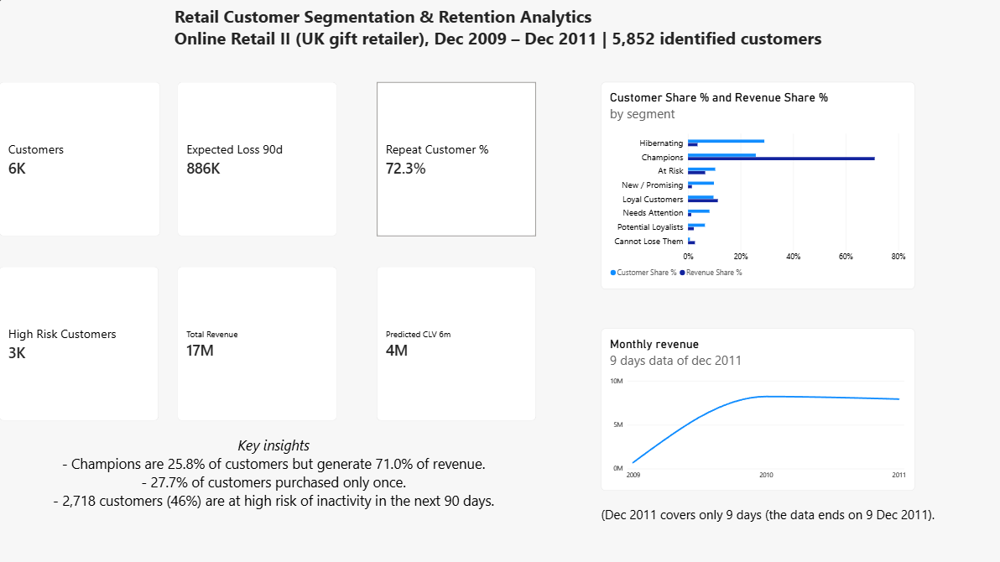
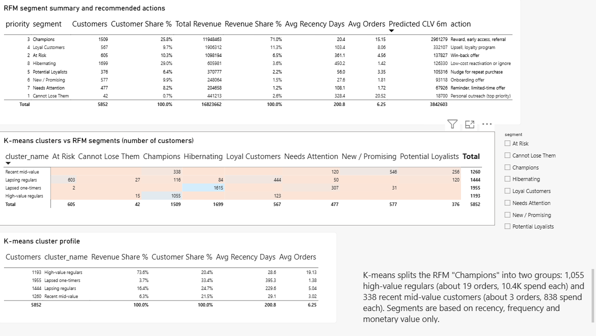
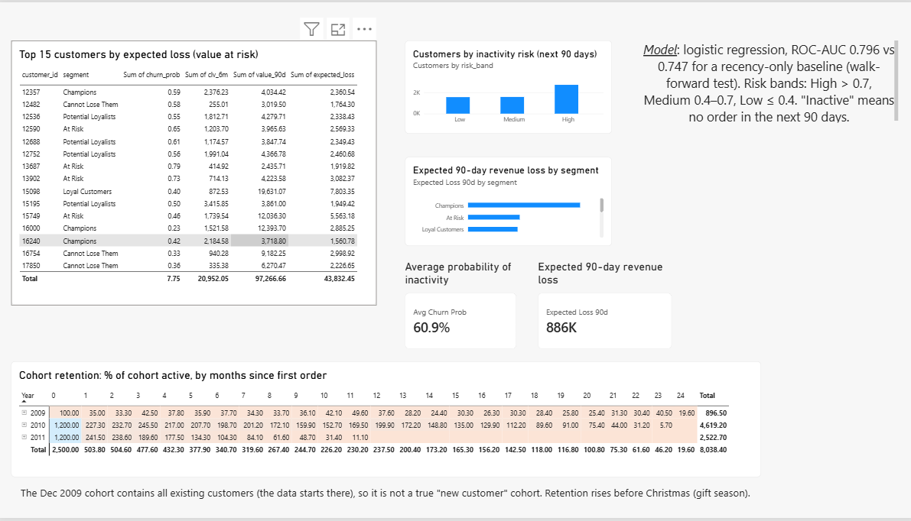
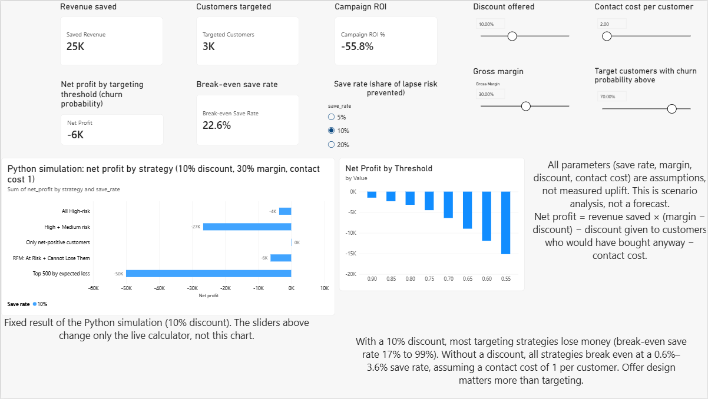
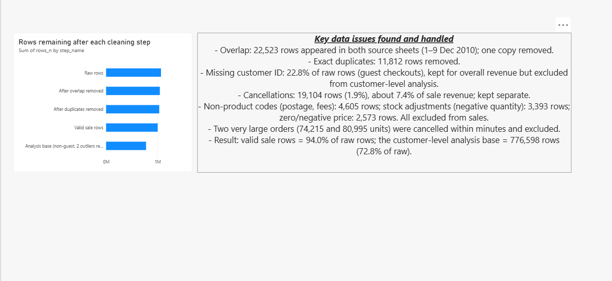

# Retail Customer Segmentation & Retention Analytics

End-to-end customer analytics on 1.07M online-retail transactions: data-quality audit, RFM and K-means segmentation, a 90-day inactivity model, 6-month customer value (CLV) estimates, a retention-campaign simulator, and a 5-page Power BI dashboard.

**Stack:** MySQL · Python (pandas, scikit-learn, SQLAlchemy) · Power BI

## Business questions
1. Which customers drive revenue, and how concentrated is it?
2. Which segments should get which retention action?
3. Who is likely to become inactive in the next 90 days, and what is that worth?
4. Under realistic assumptions, does a discount-based win-back campaign actually pay off?

## Dataset
[Online Retail II](https://archive.ics.uci.edu/dataset/502/online+retail+ii) (UCI Machine Learning Repository, Chen, D., 2019): transactions of a UK-based online gift retailer, 1 Dec 2009 – 9 Dec 2011, 1,067,371 rows in two yearly sheets. Raw data is not included in this repo (size); see "How to reproduce".

## Key findings
- **Revenue is highly concentrated.** The top 10% of customers generate 63.4% of revenue. RFM "Champions" are 25.8% of customers but 71.0% of revenue.
- **27.7% of customers bought only once**; 27.2% have not purchased in the last 365 days.
- **K-means validates RFM and adds detail.** 95% of RFM "Hibernating" and 99.7% of "At Risk" customers fall in one K-means cluster each (stability across seeds: min ARI 0.998). K-means also splits "Champions" into two groups: 1,055 high-value regulars (about 19 orders each) and 338 recent mid-value customers (about 3 orders).
- **Inactivity prediction beats a simple rule.** Walk-forward ROC-AUC 0.796 (logistic regression) vs 0.747 for a "no order in 90 days" baseline; the gain is consistent across all four test periods. Monetary value and recency are the strongest signals.
- **CLV model ranks customers well but is only slightly better than a "last 6 months revenue" baseline** (Spearman 0.600 vs 0.569; top 10% of customers capture about 62% of actual revenue, 71% is the maximum possible). It is more useful for ranking than for exact forecasts.
- **Offer design matters more than targeting.** With a 10% discount, most targeting strategies lose money (break-even save rate 17% to 99%) because the discount also goes to customers who would have bought anyway. Without a discount, every strategy breaks even at a 0.6%–3.6% save rate (assuming contact cost of 1 per customer).

## Data quality audit
| Step | Rows | Removed |
|---|---|---|
| Raw | 1,067,371 | |
| After removing overlap between the two sheets (1–9 Dec 2010, exact copies) | 1,044,848 | 22,523 |
| After removing exact duplicates | 1,033,036 | 11,812 |
| Valid sale rows | 1,003,361 | 29,675 (cancellations, non-product codes, stock adjustments, zero/negative price) |
| Customer-level analysis base (identified customers, 2 outlier orders removed) | 776,598 | |

Other findings: 22.8% of raw rows have no customer ID (guest checkouts), cancellations are about 7.4% of sale revenue, and two orders of 74,215 and 80,995 units were cancelled within minutes and excluded.

## Methodology (short)
- **RFM:** reference date 10 Dec 2011; scores 1–5 via percent rank; 8 rule-based segments with recommended actions.
- **K-means:** log-scaled R, F, M; k = 4 chosen by silhouette (0.366) within 3–6.
- **Inactivity model:** snapshots 90 days apart; features use only data before the snapshot; label = no order in the next 90 days. Walk-forward validation (train on earlier snapshots, test on the next), compared with a recency-only baseline.
- **CLV:** expected revenue over the next 180 days; gradient boosting (Poisson loss) validated against actual future revenue; includes a peak-season flag.
- **Simulator:** `net profit = saved revenue × (margin − discount) − discount given to customers who would have bought anyway − contact cost`. All parameters are assumptions, and it is scenario analysis, not measured uplift.

## Dashboard
Built in Power BI from exported CSVs (`data/powerbi`). Pages: Overview, Segments, Churn & Retention, Retention Simulator (live what-if parameters), Data Quality.







PDF export: `outputs/dashboard/retail_dashboard.pdf`. Power BI file: `powerbi/retail_dashboard.pbix`.

## Limitations
- Revenue is gross sales; there is no cost data, so margin in the simulator is an assumption.
- Customers without an ID (22.8% of rows) cannot be linked to customers and are excluded from customer-level analysis.
- "Inactive" (no order in 90 days) is not the same as churn: about 17% of repeat purchase gaps are longer than 90 days.
- The Dec 2009 cohort contains all existing customers (the data starts there); Dec 2011 covers only 9 days.
- Strong seasonality (gift season) with only two years of data limits the CLV model; total predicted revenue should be treated as a rough estimate.
- Simulator parameters (save rate, discount, margin, contact cost) are assumptions, not measured campaign results.
- Segment rules (RFM) are heuristics.

## Repository structure
```
├── python/       data prep, K-means, inactivity model, CLV model, simulator, Power BI export
├── sql/          setup and load, profiling, cleaning audit, customer metrics, RFM, datasets, dashboard views
├── data/
│   ├── processed/  model outputs (clusters, churn scores, CLV)
│   └── powerbi/    CSVs used by the dashboard
├── outputs/      charts and dashboard screenshots / PDF
├── powerbi/      retail_dashboard.pbix
└── requirements.txt
```

## How to reproduce
1. Download `online_retail_II.xlsx` from the UCI page above into `data/raw/`.
2. `pip install -r requirements.txt`; install MySQL 8.
3. Convert and merge the two sheets: `python python/prepare_data.py` (creates `data/raw/online_retail_II.csv`).
4. In MySQL, run `sql/01_setup_and_load.sql` (set your CSV path, and allow `local_infile`), then `sql/02` to `sql/05` in order (these create tables; do not run twice).
5. Set the connection (the scripts read the password from the `MYSQL_PWD` environment variable and use a MySQL user `retail_user` with access to `retail_seg`; change it in the scripts if needed), then run `python python/05_kmeans.py`.
6. Run the table-creation parts of `sql/07_churn_dataset.sql`, then `python python/07_churn_model.py`.
7. Run the table-creation parts of `sql/08_clv_dataset.sql` (up to the dataset check), then `python python/08_clv_model.py` and `python python/08_retention_simulator.py`, then the `customer_360` view in `sql/08_clv_dataset.sql`.
8. Run `sql/09_dashboard_views.sql`, then `python python/09_export_for_powerbi.py`.
9. Open `powerbi/retail_dashboard.pbix` and update the CSV source path (Transform data → Data source settings).

## Author
Vanshika · BSc Computer Science · [LinkedIn](<your-linkedin-url>) · [GitHub](https://github.com/<gvanshika>)